# 《我的知识小栈》数据库设计文档

| 项目 | 内容 |
| --- | --- |
| 数据库 | MySQL 8.0 |
| 字符集 / 排序规则 | `utf8mb4` / `utf8mb4_0900_ai_ci` |
| 存储引擎 | InnoDB |
| 表数量 | 9 张（8 张业务实体 + 1 张浏览明细） |
| 建表脚本 | [`database/schema.sql`](../database/schema.sql) |
| ORM 模型 | [`app/models.py`](../app/models.py) |

---

## 1. 设计目标与原则

### 1.1 目标

1. 支撑主体功能：用户、文章、分类、标签、评论、收藏；
2. 支撑扩展功能：Markdown、附件、评论审核、浏览统计；
3. 保持结构清晰，适合课程讲解，不做过度设计；
4. 保证数据完整性：主键、外键、唯一约束、检查约束；
5. 兼顾查询性能：为高频过滤/排序建立组合索引；
6. 中文与 emoji 安全：全库 `utf8mb4`。

### 1.2 设计原则

| 原则 | 落地方式 |
| --- | --- |
| 第三范式为主 | 分类、标签、用户独立成表，避免重复存储 |
| 适度冗余 | `posts.view_count` 冗余累计值，便于热门排序，明细在 `post_views` |
| 逻辑删除 vs 物理删除 | 课程项目采用物理删除；删除文章级联清理评论/收藏/浏览记录 |
| 多对多显式关联 | `post_tags` 独立关联表，含联合主键与反向索引 |
| 状态用字符串 + CHECK | 可读性好，MySQL 8.0 可校验；避免 ENUM 迁移困难 |
| 时间统一 DATETIME | 服务器本地时间，Docker 统一 `Asia/Shanghai` |
| 敏感信息不落原文 | 密码只存哈希；IP 只存哈希 |

---

## 2. ER 图与实体关系

### 2.1 Mermaid ER 图

```mermaid
erDiagram
    USERS ||--o{ POSTS : "撰写"
    USERS ||--o{ COMMENTS : "发表"
    USERS ||--o{ FAVORITES : "收藏"
    USERS ||--o{ ATTACHMENTS : "上传"
    USERS ||--o{ COMMENTS : "审核"

    CATEGORIES ||--o{ POSTS : "归类"

    POSTS ||--o{ POST_TAGS : "拥有"
    TAGS ||--o{ POST_TAGS : "被使用"

    POSTS ||--o{ COMMENTS : "拥有"
    POSTS ||--o{ FAVORITES : "被收藏"
    POSTS ||--o{ POST_VIEWS : "产生浏览"

    USERS {
        int id PK
        varchar username UK
        varchar email UK
        varchar password_hash
        varchar display_name
        varchar role
        tinyint is_active
        datetime created_at
    }
    POSTS {
        int id PK
        varchar title
        longtext content_md
        longtext content_html
        int category_id FK
        int author_id FK
        varchar status
        tinyint is_top
        int view_count
        datetime published_at
    }
    CATEGORIES {
        int id PK
        varchar name UK
        varchar color
        int sort_order
    }
    TAGS {
        int id PK
        varchar name UK
        varchar color
    }
    POST_TAGS {
        int post_id PK,FK
        int tag_id PK,FK
    }
    COMMENTS {
        int id PK
        int post_id FK
        int user_id FK
        varchar guest_name
        text content
        varchar status
        int audited_by FK
    }
    FAVORITES {
        int user_id PK,FK
        int post_id PK,FK
        datetime created_at
    }
    ATTACHMENTS {
        int id PK
        int user_id FK
        varchar stored_name UK
        varchar file_path
        int file_size
    }
    POST_VIEWS {
        bigint id PK
        int post_id FK
        varchar visitor_key
        datetime viewed_at
    }
```



### 2.2 关系文字说明

1. **用户—文章（1:N）**：一个博主可以写多篇文章；每篇文章必须有且只有一个作者。外键 `posts.author_id → users.id`，删除用户时限制（`RESTRICT`），防止文章失去作者。
2. **分类—文章（1:N）**：一个分类包含多篇文章；一篇文章最多属于一个分类，也可以未分类。外键 `posts.category_id → categories.id`，删除分类时置空（`SET NULL`）。
3. **文章—标签（M:N）**：通过 `post_tags(post_id, tag_id)` 建立多对多；联合主键防止重复打标；删除文章或标签时关联记录级联删除。
4. **文章—评论（1:N）**：一篇文章多条评论；删除文章时评论级联删除。
5. **用户—评论（1:N，可空）**：登录读者评论时记录 `user_id`；游客评论时 `user_id` 为 NULL，改用 `guest_name` / `guest_email`。删除用户时 `SET NULL`，保留评论内容。
6. **用户—收藏—文章（M:N）**：`favorites` 联合主键 `(user_id, post_id)` 防止重复收藏；删除用户或文章时收藏级联删除。
7. **文章—浏览明细（1:N）**：每次有效浏览写入 `post_views`，用于 7 日趋势；删除文章时级联删除。
8. **用户—附件（1:N）**：上传者与附件一对多；删除用户时附件记录级联删除。
9. **审核关系**：`comments.audited_by → users.id`，记录审核人；删除审核人时置空，保留审核时间。

### 2.3 基数与参与度

| 关系 | 左端 | 右端 | 参与度 |
| --- | --- | --- | --- |
| 用户撰写文章 | 1 | N | 文章必须参与；用户可不写 |
| 分类包含文章 | 1 | N | 文章可未分类；分类可空 |
| 文章拥有标签 | M | N | 文章可无标签 |
| 文章拥有评论 | 1 | N | 文章可无评论 |
| 用户收藏文章 | M | N | 双方均可为空 |
| 文章产生浏览 | 1 | N | 文章可无浏览明细 |

---

## 3. 数据表结构

### 3.1 `users` 用户表

| 字段 | 类型 | 允许空 | 键 / 默认 | 说明 |
| --- | --- | :---: | --- | --- |
| id | INT UNSIGNED | 否 | PK, AI | 用户 ID |
| username | VARCHAR(50) | 否 | UK | 登录用户名，3–20 位字母数字下划线 |
| email | VARCHAR(120) | 否 | UK | 邮箱，可用于登录，不公开 |
| password_hash | VARCHAR(255) | 否 | — | Werkzeug 哈希，绝不存明文 |
| display_name | VARCHAR(50) | 否 | — | 展示昵称 |
| avatar | VARCHAR(255) | 是 | NULL | 头像 URL，空则显示首字母 |
| bio | VARCHAR(255) | 是 | NULL | 个人简介 |
| role | VARCHAR(20) | 否 | `reader` | `admin` / `reader` |
| is_active | TINYINT(1) | 否 | `1` | 是否启用 |
| created_at | DATETIME | 否 | `CURRENT_TIMESTAMP` | 注册时间 |
| last_login_at | DATETIME | 是 | NULL | 最后登录时间 |

约束：`CHECK role IN ('admin','reader')`；用户名、邮箱唯一索引。

### 3.2 `categories` 分类表

| 字段 | 类型 | 允许空 | 键 / 默认 | 说明 |
| --- | --- | :---: | --- | --- |
| id | INT UNSIGNED | 否 | PK, AI | 分类 ID |
| name | VARCHAR(50) | 否 | UK | 分类名称 |
| description | VARCHAR(255) | 是 | NULL | 分类说明 |
| color | VARCHAR(20) | 否 | `#1f6f5c` | 主题色 HEX |
| sort_order | INT | 否 | `0` | 排序值，越小越靠前 |
| created_at | DATETIME | 否 | `CURRENT_TIMESTAMP` | 创建时间 |

### 3.3 `tags` 标签表

| 字段 | 类型 | 允许空 | 键 / 默认 | 说明 |
| --- | --- | :---: | --- | --- |
| id | INT UNSIGNED | 否 | PK, AI | 标签 ID |
| name | VARCHAR(40) | 否 | UK | 标签名称 |
| color | VARCHAR(20) | 否 | `#64748b` | 标签色 HEX |
| created_at | DATETIME | 否 | `CURRENT_TIMESTAMP` | 创建时间 |

### 3.4 `posts` 文章表

| 字段 | 类型 | 允许空 | 键 / 默认 | 说明 |
| --- | --- | :---: | --- | --- |
| id | INT UNSIGNED | 否 | PK, AI | 文章 ID |
| title | VARCHAR(150) | 否 | — | 标题 |
| summary | VARCHAR(300) | 是 | NULL | 摘要，空则自动截取 |
| content_md | LONGTEXT | 否 | — | Markdown 原文 |
| content_html | LONGTEXT | 否 | — | 服务端过滤后的 HTML |
| cover_image | VARCHAR(500) | 是 | NULL | 封面 URL，空则默认 SVG |
| category_id | INT UNSIGNED | 是 | FK, NULL | 分类，删除时 SET NULL |
| author_id | INT UNSIGNED | 否 | FK | 作者 |
| status | VARCHAR(20) | 否 | `draft` | `draft` / `published` |
| is_top | TINYINT(1) | 否 | `0` | 是否置顶 |
| view_count | INT UNSIGNED | 否 | `0` | 累计浏览量（冗余） |
| created_at | DATETIME | 否 | `CURRENT_TIMESTAMP` | 创建时间 |
| updated_at | DATETIME | 否 | 自动更新 | 更新时间 |
| published_at | DATETIME | 是 | NULL | 发布时间，草稿为 NULL |

索引：`(status, published_at)` 用于公开列表排序；`category_id`；`author_id`；`is_top`。

### 3.5 `post_tags` 文章标签关联表

| 字段 | 类型 | 允许空 | 键 | 说明 |
| --- | --- | :---: | --- | --- |
| post_id | INT UNSIGNED | 否 | PK, FK | 文章 ID |
| tag_id | INT UNSIGNED | 否 | PK, FK | 标签 ID |

联合主键 `(post_id, tag_id)`；`tag_id` 单列索引用于“按标签查文章”。

### 3.6 `comments` 评论表

| 字段 | 类型 | 允许空 | 键 / 默认 | 说明 |
| --- | --- | :---: | --- | --- |
| id | INT UNSIGNED | 否 | PK, AI | 评论 ID |
| post_id | INT UNSIGNED | 否 | FK | 所属文章，级联删除 |
| user_id | INT UNSIGNED | 是 | FK, NULL | 注册用户；游客为 NULL |
| guest_name | VARCHAR(50) | 是 | NULL | 游客昵称 |
| guest_email | VARCHAR(120) | 是 | NULL | 游客邮箱，仅后台可见 |
| content | TEXT | 否 | — | 评论内容 |
| status | VARCHAR(20) | 否 | `pending` | `pending` / `approved` / `rejected` |
| ip_hash | VARCHAR(64) | 是 | NULL | IP+UA 哈希，不存原始 IP |
| created_at | DATETIME | 否 | `CURRENT_TIMESTAMP` | 提交时间 |
| audited_at | DATETIME | 是 | NULL | 审核时间 |
| audited_by | INT UNSIGNED | 是 | FK, NULL | 审核人 |

索引：`(post_id, status)` 用于文章页取已通过评论；`created_at` 用于后台排序；`user_id` 用于“我的评论”。

### 3.7 `favorites` 收藏表

| 字段 | 类型 | 允许空 | 键 / 默认 | 说明 |
| --- | --- | :---: | --- | --- |
| user_id | INT UNSIGNED | 否 | PK, FK | 用户 ID |
| post_id | INT UNSIGNED | 否 | PK, FK | 文章 ID |
| created_at | DATETIME | 否 | `CURRENT_TIMESTAMP` | 收藏时间 |

联合主键防止同一用户重复收藏同一文章；`post_id` 索引用于统计文章收藏数。

### 3.8 `attachments` 图片附件表

| 字段 | 类型 | 允许空 | 键 / 默认 | 说明 |
| --- | --- | :---: | --- | --- |
| id | INT UNSIGNED | 否 | PK, AI | 附件 ID |
| user_id | INT UNSIGNED | 否 | FK | 上传者 |
| original_name | VARCHAR(255) | 否 | — | 原始文件名 |
| stored_name | VARCHAR(255) | 否 | UK | UUID 存储名 |
| file_path | VARCHAR(500) | 否 | — | 相对 `static` 的路径 |
| mime_type | VARCHAR(100) | 否 | — | MIME 类型 |
| file_size | INT UNSIGNED | 否 | — | 字节数 |
| created_at | DATETIME | 否 | `CURRENT_TIMESTAMP` | 上传时间 |

### 3.9 `post_views` 浏览明细表

| 字段 | 类型 | 允许空 | 键 / 默认 | 说明 |
| --- | --- | :---: | --- | --- |
| id | BIGINT UNSIGNED | 否 | PK, AI | 浏览记录 ID |
| post_id | INT UNSIGNED | 否 | FK | 文章 ID |
| visitor_key | VARCHAR(64) | 是 | NULL | 访客哈希（IP+UA+密钥） |
| viewed_at | DATETIME | 否 | `CURRENT_TIMESTAMP` | 浏览时间 |

索引：`(post_id, viewed_at)` 用于单篇趋势；`viewed_at` 用于全局 7 日聚合。

---

## 4. 索引设计说明

| 索引 | 支撑查询 | 设计理由 |
| --- | --- | --- |
| `idx_posts_status_published(status, published_at)` | 首页/列表：`WHERE status='published' ORDER BY published_at DESC` | 最左前缀匹配状态，再按时间排序，避免额外排序 |
| `idx_posts_category(category_id)` | 分类筛选 | 分类页高频 |
| `idx_posts_author(author_id)` | 作者维度（为多作者扩展预留） | 外键也需要索引 |
| `idx_posts_top(is_top)` | 置顶排序 | 数据量小，辅助 |
| `idx_post_tags_tag(tag_id)` | 按标签反查文章 | 联合主键最左是 post_id，标签查询需要反向索引 |
| `idx_comments_post_status(post_id, status)` | 详情页已通过评论 | 先定位文章，再过滤状态 |
| `idx_comments_created(created_at)` | 后台按时间排序 | 审核列表 |
| `uk_favorites(user_id, post_id)` | 收藏判重 | 联合主键天然唯一 |
| `idx_favorites_post(post_id)` | 文章收藏数 | 详情页统计 |
| `idx_views_time(viewed_at)` | 7 日趋势 | 时间范围扫描 |
| `idx_views_post_time(post_id, viewed_at)` | 单篇访问分析 | 组合索引 |

**为什么搜索没有加索引？** 当前使用 `LIKE '%关键词%'`，前置通配符无法使用普通 B-Tree。强行加索引收益有限。数据量增长后的方案：

```sql
ALTER TABLE posts ADD FULLTEXT INDEX ft_posts_search (title, summary, content_md) WITH PARSER ngram;
SELECT * FROM posts WHERE MATCH(title, summary, content_md) AGAINST ('Flask' IN NATURAL LANGUAGE MODE);
```

中文全文检索需要 MySQL `ngram` 解析器，且最小 token 大小要调整。本项目在文档中说明，不为了“看起来高级”引入不稳定的演示依赖。

---

## 5. 事务与并发

### 5.1 需要事务的操作

1. **创建/编辑文章 + 同步标签**：文章写入与关联表写入必须同时成功；
2. **删除文章**：文章、评论、收藏、浏览记录级联删除；
3. **审核评论**：状态、审核时间、审核人同时更新；
4. **收藏/取消收藏**：插入/删除单条记录；
5. **上传附件**：先落盘，再写数据库；失败时清理文件（当前实现若数据库提交失败会留下孤儿文件，生产可加补偿任务）。

SQLAlchemy 的 `db.session.commit()` 将同一请求内的修改作为一个事务提交；异常时 `rollback`。

### 5.2 并发风险

| 场景 | 风险 | 当前处理 | 生产改进 |
| --- | --- | --- | --- |
| 两人同时收藏 | 联合主键冲突 | 请求串行 + 捕获异常 | `INSERT IGNORE` 或唯一冲突重试 |
| 浏览量并发 | `view_count` 丢失更新 | 单机课程项目可接受 | `UPDATE ... SET view_count = view_count + 1` 原子自增 |
| 同一文章同时编辑 | 后写覆盖 | 单博主模型，风险低 | 增加 `version` 乐观锁 |
| 评论重复提交 | 多条重复 | 20 秒会话限频 + 审核 | 前端防抖 + 幂等 token |

---

## 6. 数据安全与备份

### 6.1 安全

- 密码：Werkzeug `scrypt` 哈希，带随机盐；
- 游客邮箱：仅后台审核页展示，前台不输出；
- IP：不存原始值，只存 `sha256(IP|UA|SECRET_KEY)`；
- 上传：Pillow 真实解码，拒绝伪装图片；UUID 重命名，避免路径穿越与覆盖；
- 删除附件：校验目标路径必须位于 `uploads` 目录内。

### 6.2 备份

```bash
# 结构 + 数据
mysqldump -u blogger -p --single-transaction --routines --triggers knowledge_stack > backup_$(date +%F).sql

# 仅结构
mysqldump -u blogger -p --no-data knowledge_stack > schema_only.sql

# 恢复
mysql -u blogger -p knowledge_stack < backup_2026-10-31.sql
```

建议每天凌晨备份，保留 7 天；上传目录单独打包。Docker 环境可使用 `docker compose exec db mysqldump ...`。

---

## 7. 初始化数据设计

演示数据由 `flask seed-demo` 生成，包含：

- 1 个博主 `admin`、1 个读者 `reader`；
- 5 个分类：后端之道、前端手记、数据库、学习方法、生活随笔；
- 9 个标签：Python、Flask、MySQL、CSS、JavaScript、Markdown、复盘、效率、作品集；
- 8 篇已发布文章 + 1 篇草稿；
- 5 条评论（3 条已通过、2 条待审核）；
- 3 条收藏；
- 近 7 天共 120 条浏览明细，保证看板柱状图有形状。

数据使用固定随机种子 `20261031`，每次初始化结果稳定，便于录屏和答辩复现。

---

## 8. 完整建表 SQL

> 与 [`database/schema.sql`](../database/schema.sql) 完全一致。推荐直接执行该文件，下面为便于文档阅读的完整副本。

```sql
CREATE DATABASE IF NOT EXISTS `knowledge_stack`
  DEFAULT CHARACTER SET utf8mb4
  COLLATE utf8mb4_0900_ai_ci;

USE `knowledge_stack`;
SET NAMES utf8mb4;
SET FOREIGN_KEY_CHECKS = 0;
DROP TABLE IF EXISTS `post_views`;
DROP TABLE IF EXISTS `attachments`;
DROP TABLE IF EXISTS `favorites`;
DROP TABLE IF EXISTS `comments`;
DROP TABLE IF EXISTS `post_tags`;
DROP TABLE IF EXISTS `posts`;
DROP TABLE IF EXISTS `tags`;
DROP TABLE IF EXISTS `categories`;
DROP TABLE IF EXISTS `users`;
SET FOREIGN_KEY_CHECKS = 1;

CREATE TABLE `users` (
  `id`            INT UNSIGNED NOT NULL AUTO_INCREMENT COMMENT '用户ID',
  `username`      VARCHAR(50)  NOT NULL COMMENT '登录用户名，3-20位字母数字下划线',
  `email`         VARCHAR(120) NOT NULL COMMENT '邮箱，可用于登录',
  `password_hash` VARCHAR(255) NOT NULL COMMENT 'Werkzeug 密码哈希，绝不存明文',
  `display_name`  VARCHAR(50)  NOT NULL COMMENT '展示昵称',
  `avatar`        VARCHAR(255) DEFAULT NULL COMMENT '头像URL，空则显示昵称首字母',
  `bio`           VARCHAR(255) DEFAULT NULL COMMENT '个人简介',
  `role`          VARCHAR(20)  NOT NULL DEFAULT 'reader' COMMENT '角色：admin/reader',
  `is_active`     TINYINT(1)   NOT NULL DEFAULT 1 COMMENT '是否启用：1是 0否',
  `created_at`    DATETIME     NOT NULL DEFAULT CURRENT_TIMESTAMP COMMENT '注册时间',
  `last_login_at` DATETIME     DEFAULT NULL COMMENT '最后登录时间',
  PRIMARY KEY (`id`),
  UNIQUE KEY `uk_users_username` (`username`),
  UNIQUE KEY `uk_users_email` (`email`),
  KEY `idx_users_role` (`role`),
  CONSTRAINT `chk_users_role` CHECK (`role` IN ('admin', 'reader'))
) ENGINE=InnoDB DEFAULT CHARSET=utf8mb4 COLLATE=utf8mb4_0900_ai_ci COMMENT='用户表';

CREATE TABLE `categories` (
  `id`          INT UNSIGNED NOT NULL AUTO_INCREMENT COMMENT '分类ID',
  `name`        VARCHAR(50)  NOT NULL COMMENT '分类名称，唯一',
  `description` VARCHAR(255) DEFAULT NULL COMMENT '分类说明',
  `color`       VARCHAR(20)  NOT NULL DEFAULT '#1f6f5c' COMMENT '主题色，HEX格式',
  `sort_order`  INT          NOT NULL DEFAULT 0 COMMENT '排序值，越小越靠前',
  `created_at`  DATETIME     NOT NULL DEFAULT CURRENT_TIMESTAMP COMMENT '创建时间',
  PRIMARY KEY (`id`),
  UNIQUE KEY `uk_categories_name` (`name`),
  KEY `idx_categories_sort` (`sort_order`)
) ENGINE=InnoDB DEFAULT CHARSET=utf8mb4 COLLATE=utf8mb4_0900_ai_ci COMMENT='文章分类表';

CREATE TABLE `tags` (
  `id`         INT UNSIGNED NOT NULL AUTO_INCREMENT COMMENT '标签ID',
  `name`       VARCHAR(40)  NOT NULL COMMENT '标签名称，唯一',
  `color`      VARCHAR(20)  NOT NULL DEFAULT '#64748b' COMMENT '标签色，HEX格式',
  `created_at` DATETIME     NOT NULL DEFAULT CURRENT_TIMESTAMP COMMENT '创建时间',
  PRIMARY KEY (`id`),
  UNIQUE KEY `uk_tags_name` (`name`)
) ENGINE=InnoDB DEFAULT CHARSET=utf8mb4 COLLATE=utf8mb4_0900_ai_ci COMMENT='文章标签表';

CREATE TABLE `posts` (
  `id`           INT UNSIGNED NOT NULL AUTO_INCREMENT COMMENT '文章ID',
  `title`        VARCHAR(150) NOT NULL COMMENT '标题',
  `summary`      VARCHAR(300) DEFAULT NULL COMMENT '摘要，为空时由正文自动截取',
  `content_md`   LONGTEXT     NOT NULL COMMENT 'Markdown原文',
  `content_html` LONGTEXT     NOT NULL COMMENT '服务端渲染并过滤后的HTML',
  `cover_image`  VARCHAR(500) DEFAULT NULL COMMENT '封面图URL，空则使用默认SVG',
  `category_id`  INT UNSIGNED DEFAULT NULL COMMENT '所属分类，删除分类时置空',
  `author_id`    INT UNSIGNED NOT NULL COMMENT '作者（博主）ID',
  `status`       VARCHAR(20)  NOT NULL DEFAULT 'draft' COMMENT '状态：draft/published',
  `is_top`       TINYINT(1)   NOT NULL DEFAULT 0 COMMENT '是否置顶：1是 0否',
  `view_count`   INT UNSIGNED NOT NULL DEFAULT 0 COMMENT '累计浏览量（冗余字段，便于排序）',
  `created_at`   DATETIME     NOT NULL DEFAULT CURRENT_TIMESTAMP COMMENT '创建时间',
  `updated_at`   DATETIME     NOT NULL DEFAULT CURRENT_TIMESTAMP ON UPDATE CURRENT_TIMESTAMP COMMENT '更新时间',
  `published_at` DATETIME     DEFAULT NULL COMMENT '发布时间，草稿为NULL',
  PRIMARY KEY (`id`),
  KEY `idx_posts_status_published` (`status`, `published_at`),
  KEY `idx_posts_category` (`category_id`),
  KEY `idx_posts_author` (`author_id`),
  KEY `idx_posts_top` (`is_top`),
  CONSTRAINT `fk_posts_category` FOREIGN KEY (`category_id`) REFERENCES `categories` (`id`) ON DELETE SET NULL ON UPDATE CASCADE,
  CONSTRAINT `fk_posts_author` FOREIGN KEY (`author_id`) REFERENCES `users` (`id`) ON DELETE RESTRICT ON UPDATE CASCADE,
  CONSTRAINT `chk_posts_status` CHECK (`status` IN ('draft', 'published'))
) ENGINE=InnoDB DEFAULT CHARSET=utf8mb4 COLLATE=utf8mb4_0900_ai_ci COMMENT='文章/笔记表';

CREATE TABLE `post_tags` (
  `post_id` INT UNSIGNED NOT NULL COMMENT '文章ID',
  `tag_id`  INT UNSIGNED NOT NULL COMMENT '标签ID',
  PRIMARY KEY (`post_id`, `tag_id`),
  KEY `idx_post_tags_tag` (`tag_id`),
  CONSTRAINT `fk_post_tags_post` FOREIGN KEY (`post_id`) REFERENCES `posts` (`id`) ON DELETE CASCADE ON UPDATE CASCADE,
  CONSTRAINT `fk_post_tags_tag`  FOREIGN KEY (`tag_id`)  REFERENCES `tags` (`id`)  ON DELETE CASCADE ON UPDATE CASCADE
) ENGINE=InnoDB DEFAULT CHARSET=utf8mb4 COLLATE=utf8mb4_0900_ai_ci COMMENT='文章标签关联表';

CREATE TABLE `comments` (
  `id`          INT UNSIGNED NOT NULL AUTO_INCREMENT COMMENT '评论ID',
  `post_id`     INT UNSIGNED NOT NULL COMMENT '所属文章ID',
  `user_id`     INT UNSIGNED DEFAULT NULL COMMENT '注册用户ID；游客为NULL',
  `guest_name`  VARCHAR(50)  DEFAULT NULL COMMENT '游客昵称',
  `guest_email` VARCHAR(120) DEFAULT NULL COMMENT '游客邮箱，仅管理员可见',
  `content`     TEXT         NOT NULL COMMENT '评论内容，2-800字',
  `status`      VARCHAR(20)  NOT NULL DEFAULT 'pending' COMMENT 'pending/approved/rejected',
  `ip_hash`     VARCHAR(64)  DEFAULT NULL COMMENT 'IP+UA哈希，不存原始IP',
  `created_at`  DATETIME     NOT NULL DEFAULT CURRENT_TIMESTAMP COMMENT '提交时间',
  `audited_at`  DATETIME     DEFAULT NULL COMMENT '审核时间',
  `audited_by`  INT UNSIGNED DEFAULT NULL COMMENT '审核人ID',
  PRIMARY KEY (`id`),
  KEY `idx_comments_post_status` (`post_id`, `status`),
  KEY `idx_comments_created` (`created_at`),
  KEY `idx_comments_user` (`user_id`),
  CONSTRAINT `fk_comments_post` FOREIGN KEY (`post_id`) REFERENCES `posts` (`id`) ON DELETE CASCADE ON UPDATE CASCADE,
  CONSTRAINT `fk_comments_user` FOREIGN KEY (`user_id`) REFERENCES `users` (`id`) ON DELETE SET NULL ON UPDATE CASCADE,
  CONSTRAINT `fk_comments_auditor` FOREIGN KEY (`audited_by`) REFERENCES `users` (`id`) ON DELETE SET NULL ON UPDATE CASCADE,
  CONSTRAINT `chk_comments_status` CHECK (`status` IN ('pending', 'approved', 'rejected'))
) ENGINE=InnoDB DEFAULT CHARSET=utf8mb4 COLLATE=utf8mb4_0900_ai_ci COMMENT='评论表';

CREATE TABLE `favorites` (
  `user_id`    INT UNSIGNED NOT NULL COMMENT '用户ID',
  `post_id`    INT UNSIGNED NOT NULL COMMENT '文章ID',
  `created_at` DATETIME     NOT NULL DEFAULT CURRENT_TIMESTAMP COMMENT '收藏时间',
  PRIMARY KEY (`user_id`, `post_id`),
  KEY `idx_favorites_post` (`post_id`),
  KEY `idx_favorites_created` (`created_at`),
  CONSTRAINT `fk_favorites_user` FOREIGN KEY (`user_id`) REFERENCES `users` (`id`) ON DELETE CASCADE ON UPDATE CASCADE,
  CONSTRAINT `fk_favorites_post` FOREIGN KEY (`post_id`) REFERENCES `posts` (`id`) ON DELETE CASCADE ON UPDATE CASCADE
) ENGINE=InnoDB DEFAULT CHARSET=utf8mb4 COLLATE=utf8mb4_0900_ai_ci COMMENT='文章收藏表';

CREATE TABLE `attachments` (
  `id`            INT UNSIGNED NOT NULL AUTO_INCREMENT COMMENT '附件ID',
  `user_id`       INT UNSIGNED NOT NULL COMMENT '上传者ID',
  `original_name` VARCHAR(255) NOT NULL COMMENT '原始文件名',
  `stored_name`   VARCHAR(255) NOT NULL COMMENT 'UUID存储文件名，防重名',
  `file_path`     VARCHAR(500) NOT NULL COMMENT '相对 static 的路径，如 uploads/2026/10/xx.png',
  `mime_type`     VARCHAR(100) NOT NULL COMMENT 'MIME类型',
  `file_size`     INT UNSIGNED NOT NULL COMMENT '文件大小（字节）',
  `created_at`    DATETIME     NOT NULL DEFAULT CURRENT_TIMESTAMP COMMENT '上传时间',
  PRIMARY KEY (`id`),
  UNIQUE KEY `uk_attachments_stored` (`stored_name`),
  KEY `idx_attachments_user` (`user_id`),
  KEY `idx_attachments_created` (`created_at`),
  CONSTRAINT `fk_attachments_user` FOREIGN KEY (`user_id`) REFERENCES `users` (`id`) ON DELETE CASCADE ON UPDATE CASCADE
) ENGINE=InnoDB DEFAULT CHARSET=utf8mb4 COLLATE=utf8mb4_0900_ai_ci COMMENT='图片附件表';

CREATE TABLE `post_views` (
  `id`          BIGINT UNSIGNED NOT NULL AUTO_INCREMENT COMMENT '浏览记录ID',
  `post_id`     INT UNSIGNED NOT NULL COMMENT '文章ID',
  `visitor_key` VARCHAR(64) DEFAULT NULL COMMENT '访客标识哈希（IP+UA），不存原始IP',
  `viewed_at`   DATETIME NOT NULL DEFAULT CURRENT_TIMESTAMP COMMENT '浏览时间',
  PRIMARY KEY (`id`),
  KEY `idx_views_post_time` (`post_id`, `viewed_at`),
  KEY `idx_views_time` (`viewed_at`),
  CONSTRAINT `fk_views_post` FOREIGN KEY (`post_id`) REFERENCES `posts` (`id`) ON DELETE CASCADE ON UPDATE CASCADE
) ENGINE=InnoDB DEFAULT CHARSET=utf8mb4 COLLATE=utf8mb4_0900_ai_ci COMMENT='文章浏览明细表';
```

---

## 9. 设计取舍 FAQ

**Q1：为什么同时存 `content_md` 和 `content_html`？**
编辑需要 Markdown 原文；展示需要 HTML。每次访问都重新渲染会浪费 CPU，且历史文章可能受渲染器升级影响。冗余存储换取读取性能与稳定展示。

**Q2：为什么 `view_count` 和 `post_views` 同时存在？**
`view_count` 用于热门排序，避免每次 `COUNT(*)`；`post_views` 用于趋势。两者是“汇总 + 明细”的经典组合。当前未做定时对账，生产可加每日任务校准。

**Q3：为什么评论不直接级联删除用户？**
评论是内容资产，用户注销不应让文章讨论出现空洞。`user_id` 删除时置空，展示回退到 `guest_name` 或“匿名访客”。

**Q4：为什么不使用 ENUM？**
ENUM 在 MySQL 中新增值需要 `ALTER TABLE`，且跨库迁移不便是。`VARCHAR + CHECK` 可读、可扩展，课程项目足够。

**Q5：为什么不用逻辑删除？**
课程范围以 CRUD 为主，物理删除更直观，配合二次确认和级联清理。生产环境可加 `deleted_at` 与全局过滤。

---

> 本文档与 `app/models.py`、`database/schema.sql` 三者互为校验。修改字段时应同步更新三处，并在 PR 描述中说明迁移影响。
