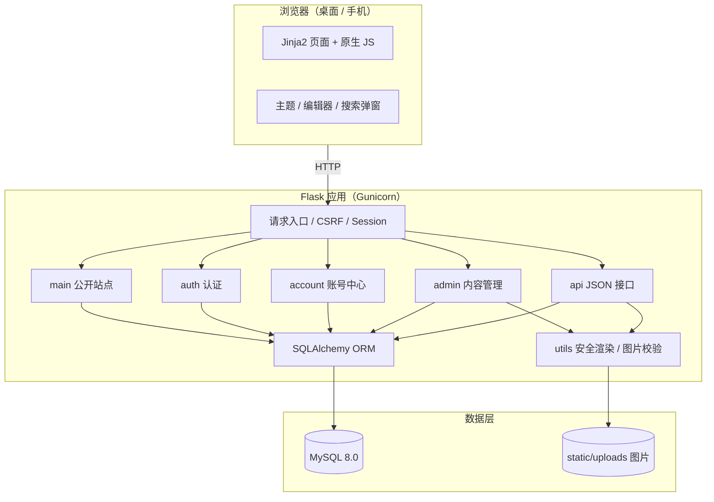
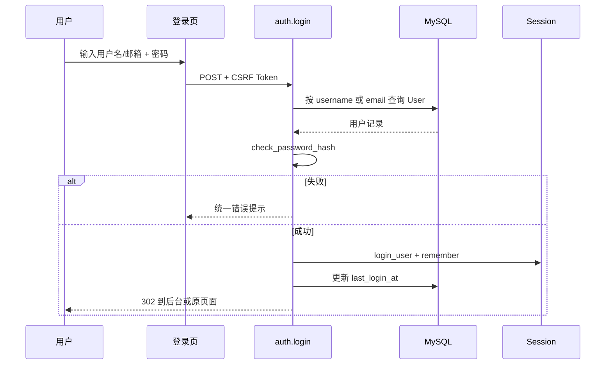
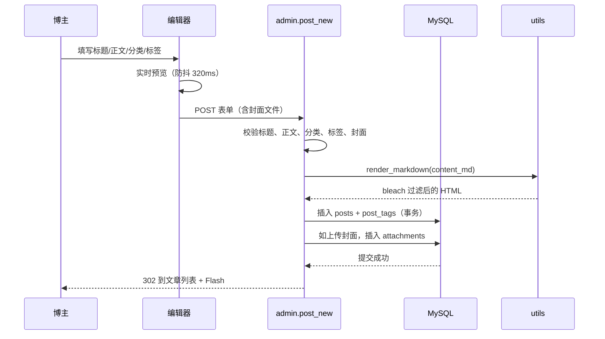
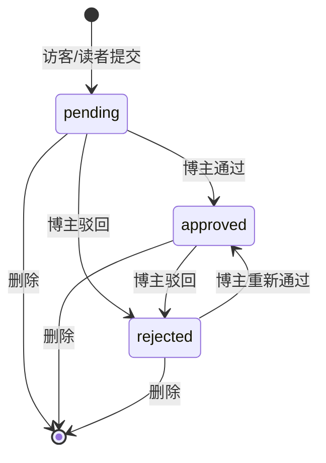
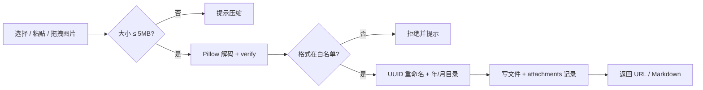
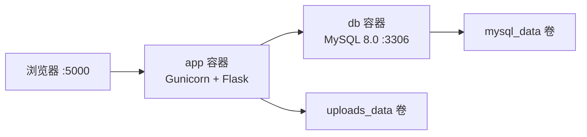

# 《我的知识小栈》系统概要设计与模块划分

| 项目 | 内容 |
| --- | --- |
| 架构风格 | B/S 分层架构 + Flask 应用工厂 + 蓝图模块化 |
| 运行形态 | 单体 Web 应用（可水平扩展无状态 Web 层） |
| 前端形态 | 服务端渲染 Jinja2 模板 + 原生 JS 渐进增强 |
| 数据存储 | MySQL 8.0（业务数据）+ 本地文件系统（图片） |
| 部署 | Docker Compose / Gunicorn + Nginx（可选） |

---

## 1. 设计目标

1. **可运行**：课程环境一条命令启动，前台/后台/数据库全部可用；
2. **可维护**：按业务拆分蓝图，配置与代码分离，关键逻辑有注释；
3. **可测试**：应用工厂允许注入测试配置，核心流程有自动化测试；
4. **可演示**：页面美观、演示数据完整、8 分钟内能讲完闭环；
5. **可扩展**：未来可以替换搜索、对象存储、缓存，而不推翻业务层。

---

## 2. 总体架构



### 2.1 分层职责

| 层 | 组成 | 职责 | 不做什么 |
| --- | --- | --- | --- |
| 表现层 | `templates/`、`static/css`、`static/js` | 页面结构、视觉、交互、表单 | 不直接访问数据库 |
| 路由层 | `main.py`、`auth.py`、`account.py`、`admin.py`、`api.py` | 参数校验、权限、调用模型、选择模板/JSON | 不写大段 HTML |
| 领域 / 服务层 | `models.py` 属性、`utils.py` | 领域规则、Markdown 安全渲染、图片校验、摘要、访客标识 | 不依赖具体页面 |
| 数据访问层 | Flask-SQLAlchemy / `models.py` | 表映射、关系、查询 | 不处理 HTTP |
| 基础设施 | `extensions.py`、`config.py`、`cli.py` | 扩展初始化、配置、建表/种子数据 | 不包含业务分支 |

### 2.2 为什么是“服务端渲染 + 原生 JS”？

- 课程要求前端不使用复杂框架，降低讲解与维护成本；
- 博客以内容展示为主，SEO 与首屏稳定比复杂状态管理更重要；
- 服务端渲染让权限判断、数据过滤发生在服务端，减少前端越权风险；
- 原生 JS 只负责主题、弹窗、编辑器预览、上传等渐进增强，即使 JS 失败，核心浏览与表单仍可用。

---

## 3. 模块划分

### 3.1 模块总览

```text
我的知识小栈
├─ 认证模块
│  ├─ 登录（用户名/邮箱）
│  ├─ 读者注册
│  └─ 退出登录
├─ 公开站点模块
│  ├─ 首页（置顶/最新/热门/分类/标签）
│  ├─ 文章列表与分页
│  ├─ 搜索与组合筛选
│  ├─ 文章详情（正文/目录/上下篇/相关）
│  ├─ 游客与读者评论
│  ├─ 收藏 / 取消收藏
│  └─ 关于页
├─ 账号中心模块
│  ├─ 资料修改
│  ├─ 密码修改
│  ├─ 我的收藏
│  └─ 我的评论
├─ 后台管理模块
│  ├─ 数据看板
│  ├─ 文章管理（CRUD / 草稿 / 发布 / 置顶）
│  ├─ 分类管理
│  ├─ 标签管理
│  ├─ 评论审核
│  └─ 图片附件
├─ 接口模块
│  ├─ Markdown 实时预览
│  └─ 图片上传
└─ 公共能力
   ├─ Markdown 安全渲染
   ├─ 图片校验与存储
   ├─ 摘要 / 阅读时长
   ├─ 访客哈希
   └─ 分页 / 错误页 / 模板宏
```

### 3.2 模块职责矩阵

| 模块 | 关键文件 | 主要路由 | 输入 | 输出 | 依赖 |
| --- | --- | --- | --- | --- | --- |
| 认证 | `auth.py` | `/auth/login`、`/auth/register`、`/auth/logout` | 表单 | 会话 / 重定向 | User、Flask-Login |
| 公开站点 | `main.py` | `/`、`/posts`、`/posts/<id>`、`/about` | 查询参数 | HTML | Post、Category、Tag、Comment |
| 互动 | `main.py` | 评论、收藏 POST | 表单 | 重定向 + Flash | Comment、Favorite |
| 账号 | `account.py` | `/account/*` | 表单 | HTML / 重定向 | User、Favorite、Comment |
| 内容管理 | `admin.py` | `/admin/*` | 表单 / 文件 | HTML / 重定向 | 全部模型 |
| JSON 接口 | `api.py` | `/api/markdown/preview`、`/api/upload` | JSON / multipart | JSON | utils、Attachment |
| 数据模型 | `models.py` | — | — | ORM 对象 | SQLAlchemy |
| 工具 | `utils.py` | — | 文本 / 文件 | HTML / 文件元数据 | Markdown、bleach、Pillow |
| CLI | `cli.py` | `flask ...` | 命令参数 | 数据库变更 / 控制台 | 全部模型 |

### 3.3 页面与模块对应

| 页面 | 路由 | 模板 | 权限 |
| --- | --- | --- | --- |
| 首页 | `/` | `main/index.html` | 公开 |
| 文章列表 / 搜索 | `/posts`、`/search` | `main/posts.html` | 公开 |
| 详情 | `/posts/<id>` | `main/post_detail.html` | 公开（草稿仅博主） |
| 关于 | `/about` | `main/about.html` | 公开 |
| 登录 / 注册 | `/auth/*` | `auth/login.html`、`auth/register.html` | 公开 |
| 账号中心 | `/account` | `account/overview.html` | 登录 |
| 收藏 / 评论 | `/account/favorites`、`/account/comments` | `account/*.html` | 登录 |
| 看板 | `/admin/dashboard` | `admin/dashboard.html` | 博主 |
| 文章列表 / 编辑 | `/admin/posts*` | `admin/posts.html`、`admin/post_form.html` | 博主 |
| 分类 / 标签 | `/admin/categories`、`/admin/tags` | `admin/categories.html`、`admin/tags.html` | 博主 |
| 评论审核 | `/admin/comments` | `admin/comments.html` | 博主 |
| 附件 | `/admin/attachments` | `admin/attachments.html` | 博主 |

---

## 4. 关键流程设计

### 4.1 登录流程



关键点：

- 用户名/邮箱任一匹配，统一错误信息；
- `next` 参数经过 `is_safe_url`，防止开放重定向；
- 读者登录后跳首页，博主跳看板。

### 4.2 发布文章流程



一致性：文章与标签关联在同一事务；封面文件先落盘，再写附件记录；如数据库失败，当前版本可能留下孤儿文件，生产可增加清理任务。

### 4.3 评论审核流程



- 前台只查询 `status='approved'`；
- 审核动作记录 `audited_at` 与 `audited_by`；
- 评论内容纯文本输出，防止 HTML 注入；
- 游客邮箱只在后台展示，前台不输出。

### 4.4 图片上传流程



安全点：

- 不信任扩展名，使用 Pillow 真实解码；
- 拒绝 SVG（可携带脚本）；
- UUID 文件名避免路径穿越与覆盖；
- 删除时校验目标文件位于 `uploads` 根目录内。

### 4.5 浏览统计流程

```text
GET /posts/<id>
  → 是否已发布？
  → 是否博主预览？
  → 当前 session 是否已记录该文章？
      ├─ 是：不重复计数
      └─ 否：posts.view_count += 1
              INSERT post_views(post_id, visitor_key, viewed_at)
              session.viewed_posts 保留最近 30 篇
```

看板读取：

- 总阅读：`SUM(posts.view_count)`；
- 今日 / 7 日：按 `post_views.viewed_at` 统计；
- 7 日趋势：查询近 7 天明细，在 Python 侧按日期聚合（兼容 SQLite）；
- 分类分布：`categories LEFT JOIN posts` 统计已发布文章。

### 4.6 搜索流程

```text
输入 q（≤80 字符）
  → 去除首尾空白
  → LIKE '%q%' 匹配 title / summary / content_md
  → 可选 category_id 等值过滤
  → 可选 tag_id JOIN post_tags
  → status='published'
  → ORDER BY is_top DESC, published_at DESC
  → 分页（每页 6）
```

当前实现优先保证“能搜到、能组合、结果正确”，并在文档中明确 `LIKE` 的性能边界与升级方案。

---

## 5. 权限与安全设计

### 5.1 认证与授权

| 层次 | 机制 |
| --- | --- |
| 认证 | Flask-Login session；密码 Werkzeug scrypt 哈希 |
| 角色 | `User.role`：`admin` / `reader` |
| 路由保护 | `@login_required`、`admin_bp.before_request` |
| 模板保护 | 仅作为显示层隐藏入口，不作为安全边界 |
| 对象级权限 | 草稿仅博主可预览；后台全部博主专属 |
| CSRF | Flask-WTF 全局保护所有 POST；API 从 `X-CSRFToken` 读取 |

### 5.2 输入校验清单

| 输入 | 校验 |
| --- | --- |
| 用户名 | 3–20 位字母数字下划线，唯一 |
| 邮箱 | 正则格式，唯一，转小写 |
| 密码 | ≥8 位，同时包含字母与数字，确认一致 |
| 标题 | 2–150 字符 |
| 摘要 | ≤300 字符，空则自动生成 |
| 正文 | 10–200000 字符 |
| 分类 | 必须存在，否则报错 |
| 标签 | ID 必须存在；新建 ≤5 个，每个 ≤20 字符 |
| 封面 | http(s) 或 `/static/` 路径 |
| 评论 | 2–800 字符；游客昵称 2–20；邮箱可选但格式正确 |
| 图片 | 真实格式 JPEG/PNG/GIF/WEBP；≥16×16；≤5MB |
| 页码 | ≥1，最大 per_page 限制 |

### 5.3 输出编码

- Jinja2 默认自动转义所有变量；
- 文章正文是唯一使用 `|safe` 的位置，内容已在服务端经 bleach 过滤；
- 评论、昵称、摘要、标题均不使用 `|safe`；
- JSON 响应由 Flask `jsonify` 序列化，自动设置 `application/json`。

### 5.4 错误处理

| 状态码 | 场景 | 页面 / 响应 |
| --- | --- | --- |
| 400 | 参数错误 / CSRF 过期 | `errors/400.html`；API 返回 JSON |
| 403 | 读者访问后台 | `errors/403.html` |
| 404 | 文章不存在 / 草稿被访客访问 | `errors/404.html` |
| 413 | 请求体过大 | `errors/413.html`；API 返回 JSON |
| 500 | 未捕获异常 | 回滚事务 + `errors/500.html` |

---

## 6. 数据库访问设计

### 6.1 查询预加载

列表页统一使用：

```python
POST_LOADS = (
    joinedload(Post.category),
    joinedload(Post.author),
    selectinload(Post.tags),
)
```

- 多对一用 `joinedload`，避免逐条查询分类/作者；
- 多对多用 `selectinload`，避免 JOIN 笛卡尔积；
- 分页只加载当前页数据；
- 卡片不调用会触发评论懒加载的属性。

### 6.2 事务边界

- 一个 HTTP 请求内的修改在同一 session 中提交；
- 文章 + 标签关联、评论审核、收藏切换均一次 `commit`；
- 异常由全局 500 处理器 `rollback`；
- 删除文章依赖 ORM 级联 + 数据库外键双保险。

### 6.3 索引与分页

- 公开列表使用 `(status, published_at)` 组合索引；
- 评论审核使用 `created_at`；
- 分页使用 Flask-SQLAlchemy `db.paginate`，`error_out=False` 让超范围页码显示空列表而不是 404。

---

## 7. 前端设计概要

| 方面 | 方案 |
| --- | --- |
| 模板 | Jinja2 继承：`base.html` → 页面模板；后台继承 `admin/base_admin.html` |
| 组件 | 宏：图标、头像、文章卡片、分页、空状态、状态徽章 |
| 样式 | 单文件 `style.css`，CSS 变量 + BEM 风格类名 + Grid/Flex |
| 主题 | `data-theme` + `localStorage` + 系统偏好；首屏内联脚本防闪烁 |
| 响应式 | 1180 / 1020 / 860 / 640 / 400 五个断点 |
| 交互 | 原生 JS：主题、导航、搜索弹窗、复制、字数、确认、编辑器 |
| 无外网依赖 | 本地 SVG 封面、本地字体栈、无 CDN |
| 可访问性 | skip link、焦点样式、aria 属性、`prefers-reduced-motion` |

详细页面地图、线框图、设计令牌见《04 前端页面规划与原型说明》。

---

## 8. 部署架构

### 8.1 开发环境

```text
浏览器 → Flask dev server (127.0.0.1:5000) → 本机 MySQL 8.0
```

### 8.2 Docker 环境



- `app` 依赖 `db` 健康检查；
- 首次启动执行 `init-db` + `seed-demo`；
- 上传目录与数据库均使用命名卷持久化；
- 生产可在前面加 Nginx 做 TLS、静态文件与限流。

### 8.3 生产建议

| 项 | 建议 |
| --- | --- |
| Web 服务器 | Nginx + Gunicorn（2–4 workers） |
| HTTPS | Let's Encrypt / 云厂商证书 |
| 数据库 | 独立 MySQL 实例，强密码，仅内网访问 |
| 备份 | 每日 `mysqldump` + 上传目录打包 |
| 日志 | Gunicorn access log + 应用日志轮转 |
| 监控 | 健康检查 `/`、数据库连接、磁盘空间 |
| 密钥 | 环境变量 / Secret Manager，定期轮换 |

---

## 9. 目录结构与代码组织

```text
app/
├─ __init__.py       # create_app：装配扩展、蓝图、过滤器、错误页、CLI
├─ extensions.py     # db / login_manager / csrf 单例
├─ models.py         # 9 张表 + 领域属性
├─ auth.py           # 认证蓝图
├─ main.py           # 公开站点蓝图
├─ account.py        # 账号蓝图
├─ admin.py          # 后台蓝图
├─ api.py            # JSON 接口蓝图
├─ utils.py          # 纯函数 / 安全工具
├─ cli.py            # 初始化与演示数据
├─ templates/        # 页面
└─ static/           # CSS / JS / SVG / 上传
```

约定：

- 路由函数只做“取参数 → 校验 → 调模型 → 返回”；
- 可复用逻辑放 `utils.py`，避免在多个路由复制；
- 模型属性只做轻量计算，不发复杂查询；
- 模板不直接写 SQL / 复杂 Python；
- 配置从环境变量读取，不在代码里写生产密钥。

---

## 10. 测试设计

| 测试层级 | 工具 | 覆盖 |
| --- | --- | --- |
| 单元 | pytest | Markdown 过滤、图片校验、摘要 |
| 集成 | Flask test client | 登录、权限、CRUD、搜索、评论、收藏、上传 |
| 页面冒烟 | Flask test client | 前台 5 页 + 后台 13 页 |
| 手工 | 浏览器 | 双主题、响应式、编辑器、上传、复制 |

测试数据库使用临时 SQLite 文件，每个测试用例独立建表/销毁，不依赖本机 MySQL。生产使用 MySQL，SQL 由 ORM 生成，主要差异已在模型中使用 `with_variant` 处理（如 `post_views.id` 在 SQLite 下为 INTEGER 以支持自增）。

---

## 11. 设计模式与取舍

| 模式 / 决策 | 使用位置 | 理由 |
| --- | --- | --- |
| 应用工厂 | `create_app()` | 便于测试注入配置、避免全局应用状态 |
| 蓝图 | 5 个蓝图 | 按业务拆分，减少合并冲突 |
| 模板继承 | `base.html` | 统一页头页脚，减少重复 |
| 宏 | `_macros.html` | 卡片/分页/图标复用 |
| 策略式白名单 | bleach | 只允许安全标签，默认拒绝 |
| 冗余汇总 | `posts.view_count` | 热门排序无需聚合全表 |
| 软状态机 | 评论 pending/approved/rejected | 审核流程清晰，可回退 |
| 渐进增强 | 原生 JS | JS 失败仍可浏览和提交表单 |

**明确没有采用的方案：**

- 没有引入 Vue/React：课程要求原生前端，且博客不需要复杂状态；
- 没有引入 Redis：当前数据量小，增加部署复杂度；
- 没有做微服务：单体足够，拆分会增加课程讲解与运维成本；
- 没有做逻辑删除：课程范围以 CRUD 为主，物理删除 + 二次确认更直观。

---

## 12. 后续演进路线

1. **搜索**：MySQL FULLTEXT + ngram，或 Meilisearch；
2. **性能**：Redis 缓存首页/热门文章，浏览量原子自增；
3. **媒体**：对象存储 + 图片压缩/缩略图；
4. **内容**：文章版本历史、定时发布、系列专栏、RSS；
5. **互动**：评论多级回复、点赞、邮件通知；
6. **运维**：Nginx + HTTPS、日志收集、备份自动化、健康检查；
7. **协作**：多作者、草稿协作、审核流。

---

> 概要设计的目标不是把所有东西都做上，而是明确“当前做什么、为什么这样做、以后怎么扩展”。本项目的边界与取舍已在第 11 节显式记录，便于答辩时解释。
