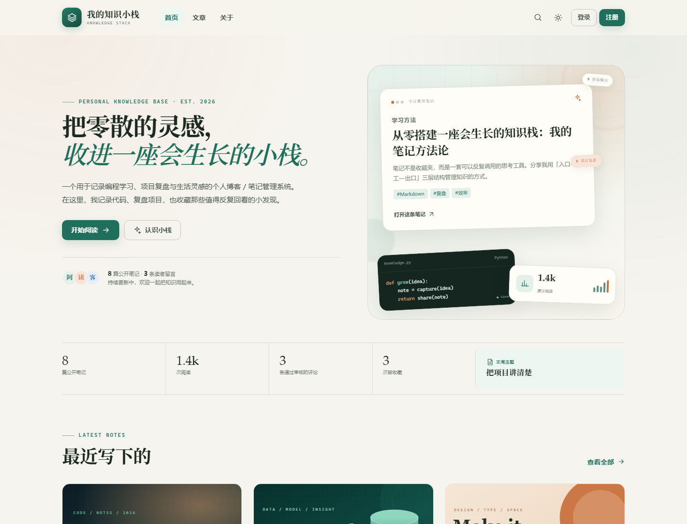
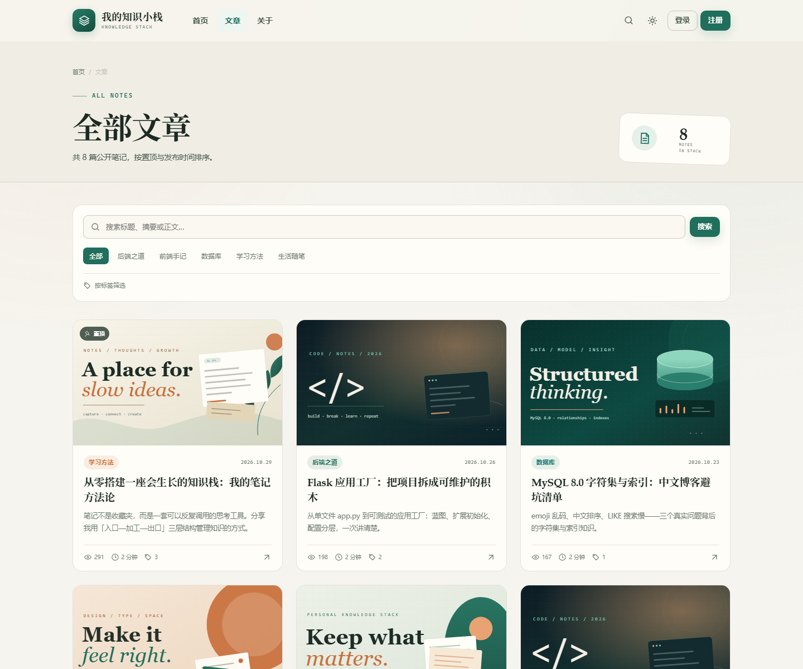
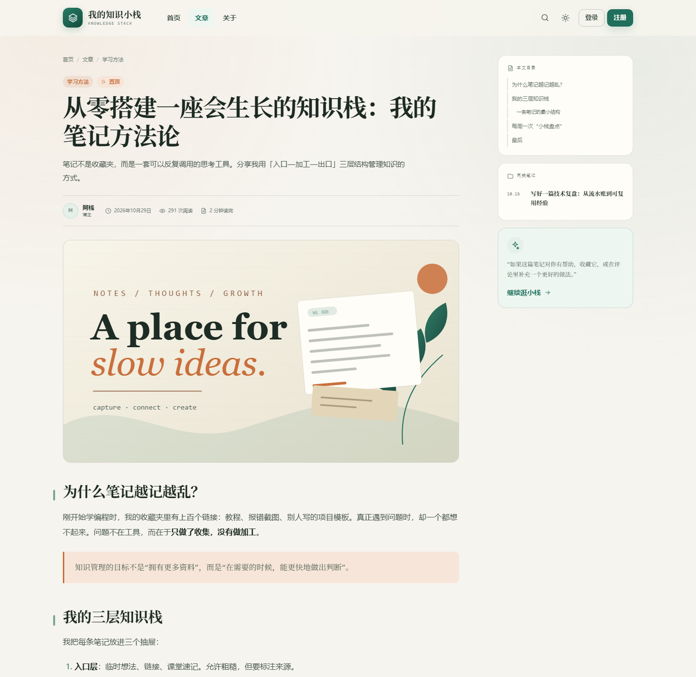
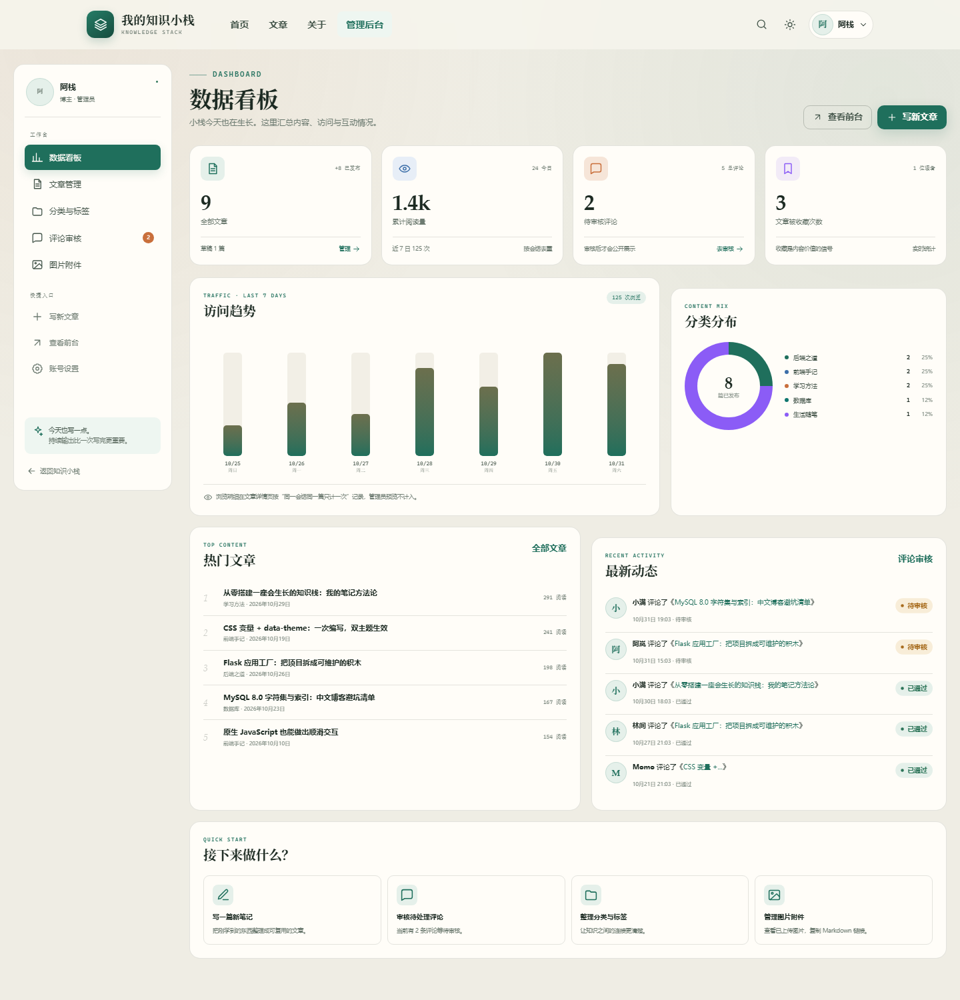

# 《我的知识小栈》前端页面规划与原型说明

| 项目 | 内容 |
| --- | --- |
| 前端技术 | HTML5 + CSS3 + 原生 ES6（无框架） |
| 模板引擎 | Jinja2（服务端渲染） |
| 设计风格 | 温暖纸张质感 + 深绿主色 + 陶土色点缀的编辑风 |
| 主题 | 浅色 / 暗黑双主题，CSS 变量统一控制 |
| 响应式 | 1180 / 1020 / 860 / 640 / 400 五个断点 |
| 统一样式 | [`app/static/css/style.css`](../app/static/css/style.css) |
| 交互脚本 | [`app.js`](../app/static/js/app.js)、[`editor.js`](../app/static/js/editor.js) |

---

## 1. 设计定位

### 1.1 关键词

**纸张、书签、手写批注、深绿、陶土、留白、编辑感。**

不是“企业后台仪表盘”，也不是“博客模板市场的通用卡片”。希望访问者第一眼感受到：这是一个有人在认真整理、持续写作的地方。

### 1.2 视觉原则

| 原则 | 具体表现 |
| --- | --- |
| 内容优先 | 正文最大宽度、舒适行高、克制装饰；封面只做氛围，不抢标题 |
| 有温度的秩序 | 米白纸感背景、深绿主色、陶土点缀；网格与手绘感线条并存 |
| 统一而非单调 | 所有页面共享同一套 token、圆角、间距、按钮与表单 |
| 双主题不是反色 | 暗黑模式降低饱和度、提高文字对比，保留品牌绿与暖橙 |
| 动效克制 | 只用于 hover、进入、主题切换；尊重 reduced-motion |
| 可访问 | 语义标签、焦点可见、键盘可操作、对比度达标 |

### 1.3 参考情绪板（文字描述）

- 颜色：旧书页 `#f6f4ee`、墨绿 `#1f6f5c`、陶土 `#c96f3b`、深墨 `#1c2a22`；
- 材质：细网格、纸张纹理、半透明玻璃页头、层叠便签；
- 字体：标题用衬线（Songti / Georgia），正文用无衬线（PingFang / Inter），代码用等宽；
- 图形：层叠卡片、环形、手绘叶片、代码窗口、印章式标签。

---

## 2. 页面地图

```text
公开区
├─ /                       首页
│  ├─ Hero + 最新文章
│  ├─ 分类导航
│  ├─ 热门文章 + 博主卡片
│  ├─ 标签云
│  └─ 注册 CTA
├─ /posts                  全部文章（搜索 / 分类 / 标签 / 分页）
├─ /posts/<id>             文章详情
│  ├─ 正文 + 自动目录
│  ├─ 收藏 / 复制链接 / 编辑
│  ├─ 上下篇 / 相关文章
│  └─ 评论列表 + 评论表单
├─ /about                  关于小栈
├─ /auth/login             登录
├─ /auth/register          注册读者
│
登录后
├─ /account                账号资料 + 修改密码
├─ /account/favorites      我的收藏
├─ /account/comments       我的评论与审核状态
│
博主后台
├─ /admin/dashboard        数据看板
├─ /admin/posts            文章管理
├─ /admin/posts/new        新建文章（Markdown 编辑器）
├─ /admin/posts/<id>/edit  编辑文章
├─ /admin/categories       分类管理
├─ /admin/tags             标签管理
├─ /admin/comments         评论审核
├─ /admin/attachments      图片附件
│
错误页
├─ 400 / 403 / 404 / 413 / 500
```

页面总数：公开 6 类、认证 2 页、账号 3 页、后台 7 页、错误 5 页。

---

## 3. 页面原型与说明

### 3.1 首页 `/`



**目标**：3 秒内让访问者知道“这是谁、写什么、从哪里开始读”。

| 区域 | 内容 | 交互 / 说明 |
| --- | --- | --- |
| 页头 | 品牌、首页/文章/关于、搜索、主题、登录/注册 | 滚动后加阴影；移动端折叠为汉堡菜单 |
| Hero 左 | 大标题、简介、两个 CTA、读者头像与统计 | 主 CTA 进入文章列表；博主登录后显示“写一篇笔记” |
| Hero 右 | 层叠便签、代码窗口、访问统计卡、浮动标签 | 纯 CSS/SVG，无外部图片；置顶文章标题真实数据 |
| 数据带 | 文章数、阅读、评论、收藏、本周主题 | 数字来自数据库；第五格为编辑手记 |
| 最新文章 | 6 张文章卡（3 列） | 封面、分类、日期、标题、摘要、阅读/时长/标签数 |
| 分类 | 5 张分类卡 | 显示文章数、说明、主题色、进入筛选 |
| 热门 + 博主 | 热门文章编号列表、博主简介卡 | 热门按浏览量；博主卡链接关于页 |
| 标签云 | 最多 12 个标签 | 标签颜色来自数据库 |
| CTA | 深绿大卡 + 层叠卡片插画 | 未登录引导注册；已登录引导收藏 |

**空状态**：没有文章时显示“小栈正在等待第一条笔记”，CTA 指向登录。

### 3.2 文章列表 `/posts`



| 区域 | 内容 | 说明 |
| --- | --- | --- |
| 页头 | 面包屑、标题、结果数、右侧印章 | 搜索时标题变为“搜索「关键词」” |
| 筛选面板 | 搜索框、分类 chips、标签折叠、当前筛选 | 组合筛选保留参数；一键清除 |
| 文章网格 | 每页 6 篇，3 列 → 2 列 → 1 列 | 置顶优先，发布时间倒序 |
| 分页 | 上一页/页码/下一页 | 空结果给搜索建议 |

**URL 参数**：

```text
/posts?q=Flask&category=1&tag=2&page=2
```

### 3.3 文章详情 `/posts/<id>`



| 区域 | 内容 | 说明 |
| --- | --- | --- |
| 面包屑 | 首页 / 文章 / 分类 | 可返回分类 |
| 文章头 | 分类、置顶、标题、摘要、作者、日期、阅读、时长 | 草稿显示“草稿预览”横幅 |
| 封面 | 16:9 大图 | 无封面不占位 |
| 正文 | Markdown 渲染、代码块、表格、引用、图片 | 最大宽度 820，行高 1.95 |
| 右侧栏 | 自动目录、同类笔记、便签卡 | 目录根据 h2/h3 生成，sticky |
| 底部 | 标签、收藏、复制链接、编辑、作者卡、上下篇 | 收藏需登录 |
| 评论 | 已通过评论、分页、表单 | 游客填昵称/邮箱；登录用户显示身份 |
| 移动端 | 单列、隐藏侧栏、代码块横滚 | 作者卡按钮换行 |

**Markdown 排版规则**：

- h2 左侧绿色短竖线；h3 略小；标题有 `scroll-margin-top`；
- 行内代码使用浅底 + 陶土色；代码块深色背景 + 横向滚动；
- 表格斑马纹、边框、移动端横向滚动；
- 引用左侧陶土竖线 + 浅橙底；
- 图片居中、圆角、边框。

### 3.4 登录 `/auth/login`

**布局**：左侧表单（60%）+ 右侧深绿插画（40%）；移动端隐藏插画。

- 用户名/邮箱 + 密码 + 记住我；
- 密码显隐按钮；
- 演示账号一键填充（仅课程演示）；
- 右侧三层便签 + 品牌标语；
- 错误通过 Flash 展示，不泄露账号是否存在。

### 3.5 注册 `/auth/register`

- 用户名、昵称、邮箱、密码、确认密码；
- 前端 `pattern` / `minlength` / `required`，后端再次校验；
- 明确提示“公开注册为读者，不具备后台权限”；
- 右侧列出读者权益：收藏、评论、持续更新。

### 3.6 账号中心 `/account`

- 左侧账号导航（资料、收藏、评论、后台入口）；
- 右侧资料表单 + 密码表单；
- 头像预览：有 URL 用图片，否则昵称首字母；
- 收藏/评论页使用文章卡片或状态列表；
- 读者看不到后台入口。

### 3.7 后台看板 `/admin/dashboard`



| 区域 | 内容 |
| --- | --- |
| 侧边栏 | 博主信息、工作台导航、待审核角标、快捷入口、便签 |
| 顶部 | 页面标题、查看前台、写新文章 |
| 四张指标卡 | 全部文章、累计阅读、待审核评论、收藏次数 |
| 访问趋势 | 近 7 日柱状图，标注今日/周总量与统计口径 |
| 分类分布 | 环形图 + 图例（数量、百分比） |
| 热门文章 | 按浏览量 Top 5 |
| 最新动态 | 最近 5 条评论及状态 |
| 快捷入口 | 写文章、审核、分类、附件 |

> 图表全部用 CSS 实现（conic-gradient / flex 柱），不依赖 Chart.js，保证离线可运行。

### 3.8 文章编辑 `/admin/posts/new`

**布局**：主编辑区（1fr）+ 右侧发布设置（300px）。

| 区域 | 内容 |
| --- | --- |
| 标题 | 大号衬线输入框 + 字数 |
| 摘要 | 2 行文本域 + 300 字计数 |
| 工具栏 | B / I / H2 / H3 / 行内代码 / 代码块 / 列表 / 引用 / 链接 / 表格 / 图片 / 预览 |
| 编辑区 | 等宽字体 textarea，支持 Tab 选中、Ctrl+B/I、粘贴/拖拽图片 |
| 预览区 | 后端渲染的安全 HTML，320ms 防抖 |
| 状态栏 | 字数、预计阅读时长、快捷键提示 |
| 右侧 | 分类、标签多选、新建标签、置顶开关、封面预览/上传、发布/草稿、文章信息 |
| 危险区 | 删除文章（二次确认） |

**发布操作**：

- `action=publish` → 发布/更新并发布；
- `action=draft` → 保存草稿/转为草稿；
- 草稿不写 `published_at`，前台不可见。

### 3.9 分类 / 标签管理

- 左侧“添加”表单 sticky；右侧列表；
- 分类行内展开编辑，支持颜色、排序、说明；
- 删除分类提示“N 篇文章将归入未分类”；
- 标签以胶囊卡片展示，显示使用次数，行内编辑名称/颜色。

### 3.10 评论审核

- 标签页：待审核 / 已通过 / 已驳回 / 全部，带数量；
- 每条评论展示头像、身份、邮箱（仅后台）、时间、状态、来源文章；
- 操作：通过 / 驳回 / 删除，均有确认或明确反馈；
- 空状态“这里很干净”。

### 3.11 图片附件

- 顶部上传区，选择文件自动提交；
- 4 列图片网格，显示缩略图、原始名、大小、日期；
- 一键复制 Markdown / URL；
- 删除二次确认，提示引用失效风险。

### 3.12 错误页

统一结构：巨型半透明状态码 + 英文 eyebrow + 中文标题 + 说明 + 返回/搜索按钮。403 根据登录状态给出“账号中心”或“切换账号”。

---

## 4. 设计令牌（Design Tokens）

### 4.1 颜色

| Token | 浅色 | 暗黑 | 用途 |
| --- | --- | --- | --- |
| `--bg` | `#f6f4ee` | `#101613` | 页面背景 |
| `--bg-subtle` | `#efede4` | `#151e19` | 分区背景 |
| `--surface` | `#fffdf8` | `#18231d` | 卡片/表单 |
| `--surface-2` | `#fbf8f1` | `#1c2821` | 次级面板 |
| `--surface-3` | `#f2efe6` | `#223029` | 标签/悬停 |
| `--text` | `#1c2a22` | `#e9efe9` | 主文字 |
| `--text-soft` | `#45564b` | `#c2d0c6` | 正文 |
| `--muted` | `#6d7b71` | `#91a398` | 辅助文字 |
| `--brand` | `#1f6f5c` | `#79c9ad` | 主色 |
| `--accent` | `#c96f3b` | `#e9a272` | 强调/暖色 |
| `--danger` | `#ad3f3f` | `#ef9b96` | 删除/错误 |
| `--line` | `rgba(28,42,34,.12)` | `rgba(233,239,233,.12)` | 边框 |

### 4.2 字体

| 用途 | 字体栈 | 说明 |
| --- | --- | --- |
| 正文 / UI | Inter, HarmonyOS Sans SC, PingFang SC, Microsoft YaHei | 清晰、跨平台 |
| 标题 / 引用 | Iowan Old Style, Palatino, Noto Serif SC, Songti SC, Georgia | 编辑感与中文衬线 |
| 代码 / 标签 | SFMono-Regular, Cascadia Code, Consolas | 等宽、易读 |

字号：

```text
Hero h1     clamp(40px, 3.65vw, 52px)
页面 h1      clamp(36px, 4.3vw, 54px)
文章 h1      clamp(34px, 4.2vw, 50px)
区块 h2      clamp(28px, 3vw, 38px)
正文         16px / 1.95
辅助         11–13px
代码         13px / 1.8
```

### 4.3 间距 / 圆角 / 阴影

| Token | 值 | 用途 |
| --- | --- | --- |
| `--radius-sm` | 10px | 按钮、输入框 |
| `--radius-md` | 16px | 卡片、面板 |
| `--radius-lg` | 24px | 大区块 |
| `--radius-xl` | 32px | Hero/CTA |
| `--shadow-sm` | 0 4px 16px rgba(23,38,30,.07) | 卡片 |
| `--shadow-md` | 0 16px 45px rgba(23,38,30,.1) | 弹窗/悬浮 |
| `--shadow-lg` | 0 30px 80px rgba(18,34,26,.16) | 搜索弹窗 |
| `--container` | 1180px | 内容最大宽度 |

---

## 5. 统一 CSS 结构

`style.css` 按以下顺序组织（约 2000 行）：

```text
1. 设计变量（light / dark）
2. 基础 reset / 排版 / 无障碍
3. 通用组件（按钮、chip、tag、avatar、status、表单）
4. 页头 / 搜索弹窗 / Flash / 页脚
5. 首页（Hero、卡片、分类、热门、标签、CTA）
6. 列表页（页头、筛选、分页、空状态）
7. 详情页（文章头、正文、侧栏、评论）
8. 认证页（左右分栏、便签视觉）
9. 后台（侧栏、指标卡、图表、表格、审核、附件）
10. 编辑器（工具栏、双栏、状态栏）
11. 账号中心
12. 关于 / 错误页
13. 响应式断点
14. reduced-motion / print
```

**命名约定**：块级 `.post-card`，元素 `.post-card__title`，状态 `.is-active`、`.is-favorited`，工具类 `.muted`、`.text-danger`。

**禁止**：

- 在模板里写 `style="color:#xxx"` 的业务颜色（数据驱动的分类色除外）；
- 为单个页面复制一套按钮样式；
- 用 `!important` 解决优先级（现有少量用于编辑器输入框覆盖浏览器默认）；
- 引入外部 UI 框架或 CDN。

---

## 6. 双主题实现

### 6.1 HTML 侧

```html
<html lang="zh-CN" data-theme="light">
```

### 6.2 首屏防闪烁脚本（放在 `<head>`）

```javascript
(function () {
  try {
    var saved = localStorage.getItem("knowledge-stack-theme");
    var prefersDark = window.matchMedia("(prefers-color-scheme: dark)").matches;
    document.documentElement.dataset.theme = saved || (prefersDark ? "dark" : "light");
  } catch (e) {
    document.documentElement.dataset.theme = "light";
  }
})();
```

### 6.3 CSS 侧

```css
:root { --bg: #f6f4ee; --text: #1c2a22; --brand: #1f6f5c; }
[data-theme="dark"] { --bg: #101613; --text: #e9efe9; --brand: #79c9ad; }
```

组件只使用变量：

```css
.card {
  background: var(--surface);
  color: var(--text);
  border: 1px solid var(--line);
}
```

### 6.4 JS 切换

- 点击按钮 → 取反；
- 写入 `localStorage`；
- 更新 `aria-pressed`；
- 更新 `<meta name="theme-color">`；
- 系统主题变化时，仅在用户未手动选择时跟随。

### 6.5 暗黑模式检查清单

- [ ] 正文与背景对比度足够；
- [ ] 代码块不刺眼，行内代码仍可区分；
- [ ] 表单 placeholder 可见；
- [ ] 分类/标签颜色在深色底上可读；
- [ ] 图表 grid 与柱体有层次；
- [ ] 图片/封面无白色硬边；
- [ ] 焦点环清晰；
- [ ] Flash 提示不透明到看不清文字。

---

## 7. 响应式规划

| 断点 | 布局变化 |
| --- | --- |
| > 1180 | 3 列文章、5 列分类、双栏详情、后台侧栏 |
| ≤ 1180 | 3 列分类、后台侧栏变窄、指标卡 2 列 |
| ≤ 1020 | Hero 单列、文章 2 列、详情侧栏移到正文下方（两列卡片） |
| ≤ 860 | 移动导航、后台侧栏隐藏改为横向滚动、编辑器单列、认证隐藏插画、关于单列 |
| ≤ 640 | 文章 1 列、分类 2 列、Hero 标题 36、表单单列、后台指标 2 列、附件 2 列 |
| ≤ 400 | 分类 1 列、隐藏统计浮卡、附件 1 列 |

移动端重点：

- 导航：绝对定位抽屉，点击链接自动关闭；
- 表格：外层 `overflow-x:auto`，后台表格隐藏次要列；
- 代码块：`overflow-x:auto`，不撑破页面；
- 图片：`max-width:100%`，封面固定比例；
- 触控目标：按钮 ≥36px，图标按钮 ≥35px；
- Flash：移动端改为底部浮层。

---

## 8. 组件清单

| 组件 | 类名 | 使用页面 | 说明 |
| --- | --- | --- | --- |
| 按钮 | `.btn` + `--primary/--ghost/--soft/--light` | 全站 | 5 种语义 |
| 标签胶囊 | `.tag-pill` | 首页/详情/筛选 | 数据驱动颜色 |
| 分类 chip | `.chip--category` | 卡片/详情 | 11% 透明背景 |
| 状态徽章 | `.status` | 后台 | 成功/中性/警告/危险 |
| 头像 | `.avatar` | 全站 | 图片或首字母 |
| 文章卡片 | `.post-card` | 首页/列表/收藏 | 封面 + 摘要 + 元信息 |
| 分页 | `.pagination` | 列表/收藏/后台 | 保留查询参数 |
| 空状态 | `.empty-state` | 全站 | 图标 + 说明 + 行动 |
| Flash | `.flash` | 全站 | 自动消失 + 手动关闭 |
| 搜索弹窗 | `.search-modal` | 全站 | `<dialog>` + `/` 快捷键 |
| 指标卡 | `.stat-card` | 看板 | 数字 + 趋势 + 脚注 |
| 柱状图 | `.bar-chart` | 看板 | 纯 CSS，百分比高度 |
| 环形图 | `.donut` | 看板 | conic-gradient |
| 数据表 | `.data-table` | 后台 | 响应式横向滚动 |
| 标签选择 | `.tag-check` | 编辑器 | checkbox 伪装胶囊 |
| 开关 | `.switch-row` | 编辑器 | 置顶开关 |
| 上传卡 | `.upload-drop` | 附件 | 选择即提交 |
| TOC | `.toc` | 详情 | JS 提取 h2/h3 |

---

## 9. 交互与可访问性

### 9.1 键盘

| 按键 | 行为 |
| --- | --- |
| `Tab` | 正常焦点顺序；skip link 首先获得焦点 |
| `/` | 非输入状态下打开搜索弹窗 |
| `Esc` | 关闭搜索 / 移动导航 / 用户菜单 |
| `Ctrl/⌘ + B` | 编辑器加粗 |
| `Ctrl/⌘ + I` | 编辑器斜体 |
| `Enter` | 表单提交 / 链接激活 |

### 9.2 ARIA 与语义

- 导航 `<nav aria-label="主导航">`；
- 搜索按钮 `aria-label`，弹窗 `aria-labelledby`；
- 主题按钮 `aria-pressed`；
- 移动菜单 `aria-expanded` + `aria-controls`；
- Flash `aria-live="polite"`；
- 表格有 `<thead>`，表单 label 与 input 关联；
- 装饰性 SVG `aria-hidden="true"`。

### 9.3 动效降级

```css
@media (prefers-reduced-motion: reduce) {
  *, *::before, *::after {
    animation-duration: .01ms !important;
    transition-duration: .01ms !important;
    scroll-behavior: auto !important;
  }
}
```

### 9.4 颜色对比

- 正文 `#45564b` 对 `#f6f4ee` 约 7:1；
- 暗黑正文 `#c2d0c6` 对 `#101613` 约 10:1；
- 主按钮白字对 `#1f6f5c` 约 5.3:1；
- 辅助文字 `#6d7b71` 对浅底约 4.6:1，满足 AA 正文下限；
- 状态色仅作辅助，不单独依赖颜色传达信息（同时有文字）。

---

## 10. 页面状态设计

每个页面至少考虑四种状态：

| 状态 | 首页 | 文章列表 | 详情 | 后台 |
| --- | --- | --- | --- | --- |
| 正常 | 有文章 | 有结果 | 已发布 | 有数据 |
| 空 | 无文章 → 引导登录 | 无结果 → 清除筛选 | 无评论 → 邀请留言 | 无评论/附件 → 空状态 |
| 错误 | 500 页 | 400/500 | 404 | 403/500 |
| 加载 | 服务端渲染无骨架；图片 lazy | 同左 | 同左 | 同左 |
| 权限 | 游客/读者/博主不同 CTA | 同左 | 草稿仅博主 | 读者 403 |

表单错误：保留输入 + Flash 具体原因；图片错误：不跳页，提示后保留表单。

---

## 11. 前端性能

| 措施 | 效果 |
| --- | --- |
| 本地 SVG 封面 | 无外部请求，体积极小，任意分辨率清晰 |
| 图片 `loading="lazy"` | 首屏只加载可见图片 |
| CSS 单文件 | 一次请求，HTTP 缓存友好 |
| JS `defer` | 不阻塞解析 |
| 文章列表分页 | 限制单页渲染量 |
| 关联预加载 | 避免 N+1 |
| 预览防抖 320ms | 减少无效请求 |
| 无第三方字体/CDN | 离线可运行，减少 DNS/连接开销 |

---

## 12. 验收清单

- [ ] 首页 1440、1024、768、500、375 宽度无布局错乱；
- [ ] 浅色/暗黑切换后刷新保持；
- [ ] 搜索弹窗可键盘打开/关闭，焦点进入输入框；
- [ ] 移动导航可打开、点链接关闭、Esc 关闭；
- [ ] 文章正文代码块、表格、引用、图片排版正确；
- [ ] 编辑器预览与详情一致；
- [ ] 后台表格在窄屏可横向滚动；
- [ ] 所有表单有 label 与错误提示；
- [ ] 删除操作均有二次确认；
- [ ] `prefers-reduced-motion` 下无明显动画；
- [ ] 打印文章时隐藏导航/评论，正文可读。

---

> 本项目的视觉不是“堆装饰”，而是用一套可复用的 token 和组件，把“个人知识小栈”的气质稳定地扩展到 20 多个页面。所有样式集中在 `style.css`，模板只负责结构与数据。
